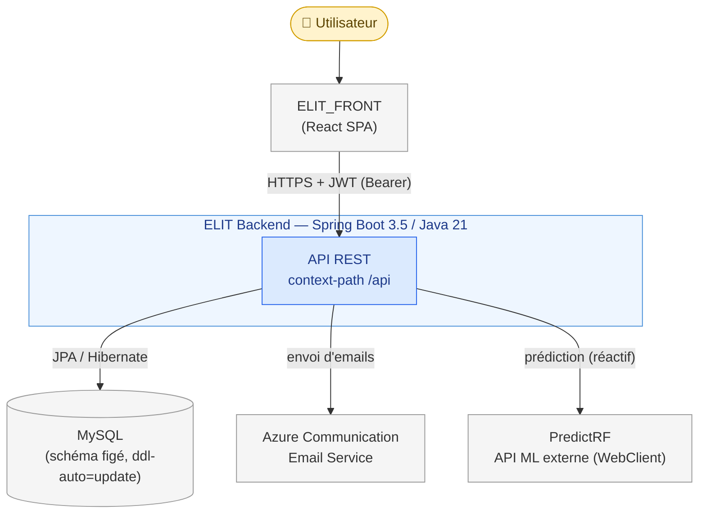
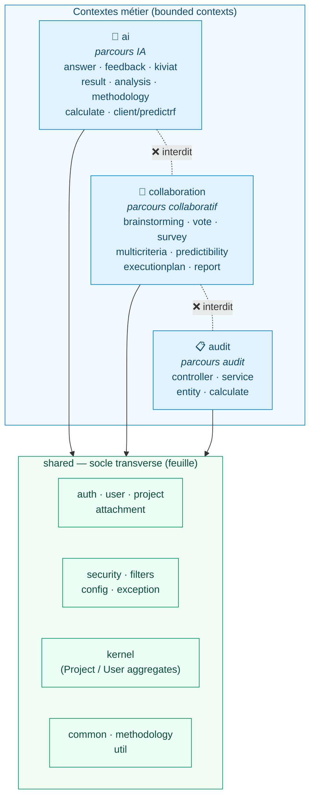
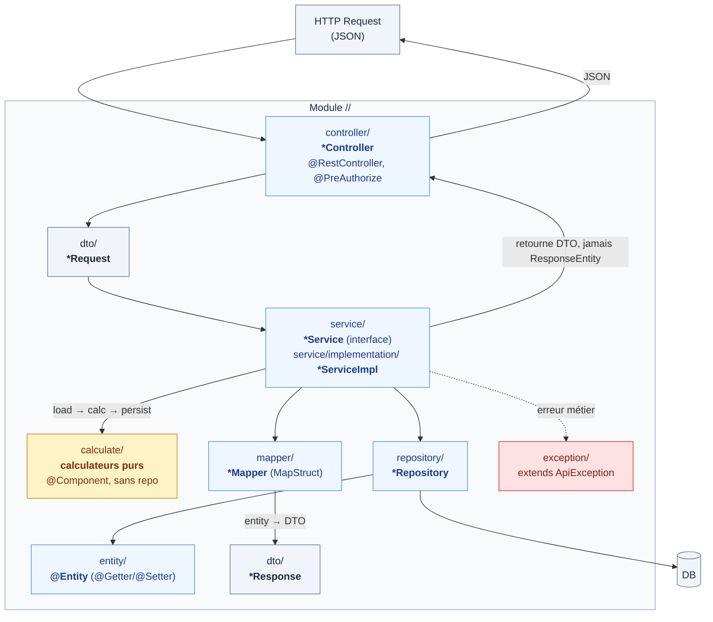
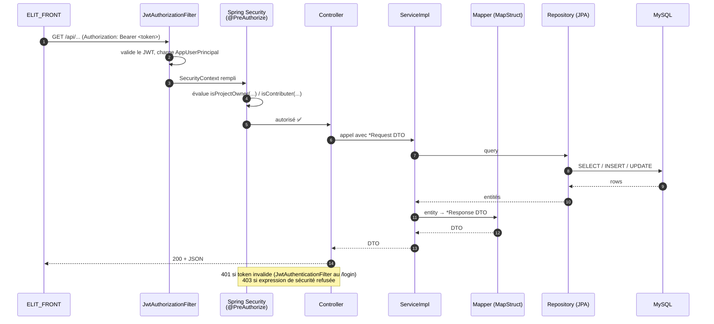
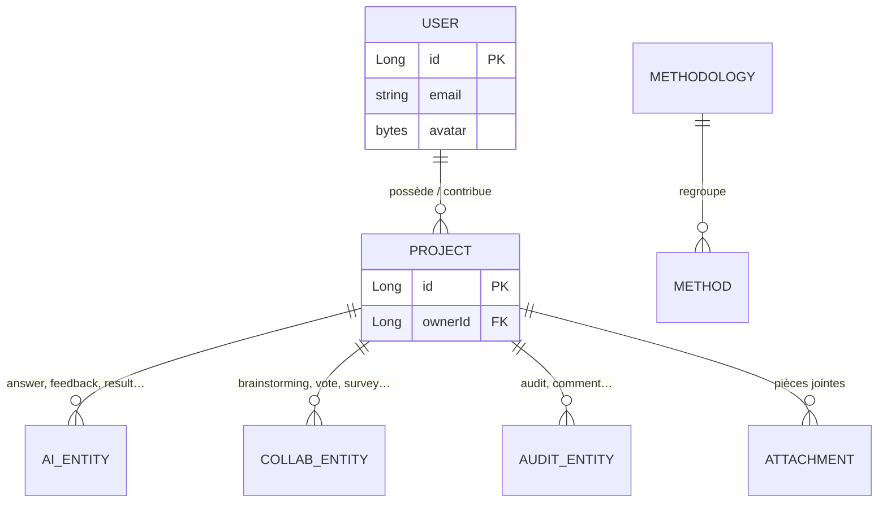
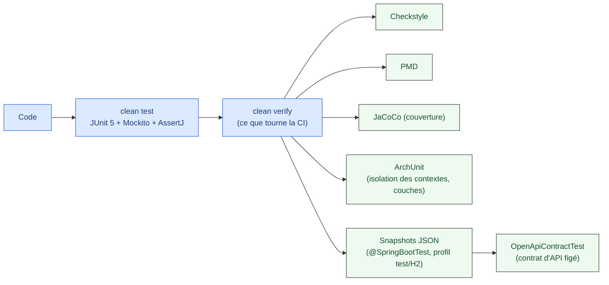

# ELIT Backend — Vue d'ensemble de l'architecture

> Document d'onboarding. Objectif : comprendre **quels sont les composants** de l'application
> et **comment ils interagissent**, en 10 minutes. Les diagrammes sont en
> [Mermaid](https://mermaid.js.org/) (rendu natif dans GitHub et l'aperçu VSCode ; sur **IntelliJ IDEA**,
> installez le plugin **Mermaid** via Settings → Plugins → Marketplace).
>
> Pour le contrat d'API, voir [ENDPOINTS_BACKEND.md](ENDPOINTS_BACKEND.md).
> Pour le détail des **règles de calcul métier**, voir [REGLES_CALCUL_METIER.md](REGLES_CALCUL_METIER.md).

---

## 1. Le système et son environnement (vue de contexte)

ELIT backend est une **API REST Spring Boot** (Java 21) qui sert l'outil d'aide à la décision ELIT.
Toutes les routes sont servies sous le context-path `/api`.



| Acteur externe                | Rôle                                                  | Techno côté back                                            |
| ----------------------------- | ----------------------------------------------------- | ----------------------------------------------------------- |
| **ELIT_FRONT**                | SPA React, seul client de l'API                       | Contrat figé ([ENDPOINTS_BACKEND.md](ENDPOINTS_BACKEND.md)) |
| **MySQL**                     | Persistance (prod/local/docker)                       | Spring Data JPA + Hibernate                                 |
| **Azure Communication Email** | Emails (confirmation inscription, reset mot de passe) | `azure-communication-email`                                 |
| **PredictRF**                 | Service ML externe de prédiction                      | Spring WebFlux `WebClient`                                  |
| **H2 (in-memory)**            | DB du profil `test` (snapshots, no network)           | uniquement en test                                          |

---

## 2. Architecture interne — bounded contexts (DDD « par parcours »)

Le code est organisé en **contextes bornés** correspondant aux parcours utilisateur.
Règle dure (vérifiée par ArchUnit) : `ai`, `collaboration` et `audit` peuvent dépendre de
`shared`, **mais jamais l'un de l'autre**. `shared` reste une feuille.



> ⚠️ **Exception documentée** : `shared.kernel` héberge les agrégats racines `Project` et `User`,
> dont les `@OneToMany` inverses référencent des entités de contexte. C'est la seule entorse
> tolérée à la règle « shared est une feuille ».

---

## 3. Anatomie d'un module (forme standard en couches)

Chaque feature, sous `<contexte>/<feature>/`, suit le même squelette en couches.
Le flux est strictement **Controller → Service → Repository** (vérifié par ArchUnit).



**Règles clés de cette couche** :

- Le **Service** retourne des **DTO**, jamais `ResponseEntity` (responsabilité du Controller).
- La **logique de calcul métier** (scoring, agrégations, pondérations) est extraite dans des
  **calculateurs purs** sous `<feature>/calculate/` (`@Component`, sans accès repository) ; le service
  orchestre `load → calc → persist` et reste fin (SRP). Exemples : `audit/calculate`,
  `collaboration/multicriteria/calculate`, `ai/kiviat/calculate`, `ai/methodology/evaluation/calculate`.
  Le détail des formules de chaque calculateur est documenté dans
  [REGLES_CALCUL_METIER.md](REGLES_CALCUL_METIER.md).
- Les **Mappers** (MapStruct) n'injectent jamais de repository/service.
- Les **Entités** : `@Getter @Setter` (jamais `@Data`), `equals`/`hashCode` sur l'ID seul,
  `FetchType.LAZY` par défaut, **aucune annotation Jackson** (la sérialisation passe par les DTO).
- Les **exceptions métier** étendent `shared/exception/ApiException` (qui porte son `HttpStatus`),
  mappées par un unique `RestResponseEntityExceptionHandler` global.
- **Contrats figés** : noms JSON via `@JsonProperty("legacyName")`, noms DB via `@Table`/`@Column`,
  URLs jamais modifiées. Seuls les messages d'erreur/validation restent en français.

---

## 4. Cycle de vie d'une requête (sécurité JWT)

Comment une requête authentifiée traverse l'application, du filtre de sécurité à la base.



**Composants de sécurité** (`shared/security` + `shared/filters`) :

| Composant                            | Rôle                                                                             |
| ------------------------------------ | -------------------------------------------------------------------------------- |
| `JwtAuthenticationFilter`            | Authentification au `/login` → émet access/refresh tokens                        |
| `JwtAuthorizationFilter`             | Valide le `Bearer` sur chaque requête, peuple le `SecurityContext`               |
| `AppUserPrincipal`                   | Identité de l'utilisateur authentifié                                            |
| `CustomMethodSecurityExpressionRoot` | Expressions `@PreAuthorize` métier : `isProjectOwner(...)`, `isContributer(...)` |
| `PermissionService`                  | Logique de droits projet/contributeur                                            |
| `SpringConfig`                       | Filter chain, encodeurs, configuration Spring Security                           |

---

## 5. Modèle de domaine — agrégats racines (kernel)

`Project` et `User` sont les agrégats racines partagés. Ils vivent dans `shared/kernel` car leurs
relations inverses pointent vers les entités des trois contextes.



> Les entités de contexte (`AI_ENTITY`, `COLLAB_ENTITY`, `AUDIT_ENTITY` ci-dessus) restent
> **dans leur contexte** ; seul l'agrégat racine `Project` les référence via des `@OneToMany` inverses.

---

## 6. Qualité, build & non-régression



- **Avant tout commit** : `clean test` puis `checkstyle:check pmd:check` doivent être verts.
- Le **harnais de snapshots** (`src/test/.../snapshot/`) fige le JSON observable des endpoints de
  contrat en bootant l'app réelle sur le profil `test` (H2, sans réseau). **On ne modifie jamais un
  snapshot pour faire passer un test** — on le re-record uniquement sur un changement de contrat acté.
- `OpenApiContractTest` fige la surface d'API : la projection `api/elit-openapi-contract.json` est le
  **hard gate** (tout changement d'URL/verbe/param/schéma casse le build).

### Commandes (PowerShell, pas de `JAVA_HOME` global)

```powershell
 .\mvnw.cmd clean test
 .\mvnw.cmd clean verify        # gate complet
 .\mvnw.cmd spring-boot:run      # nécessite un .env
```

---

## 7. Pour aller plus loin

| Sujet                   | Où regarder                                       |
| ----------------------- | ------------------------------------------------- |
| Règles de calcul métier | [REGLES_CALCUL_METIER.md](REGLES_CALCUL_METIER.md) |
| Isolation des contextes | `src/test/.../architecture/ArchitectureTest.java` |
| Point d'entrée          | `OutildedecisionApplication.java`                 |

---

## 8. Règles de code — l'essentiel (TL;DR)

Le contrat d'API est figé dans [ENDPOINTS_BACKEND.md](ENDPOINTS_BACKEND.md). En résumé :

- **Tout identifiant est en anglais** (packages, classes, méthodes, tests). Seuls les messages
  d'erreur/validation destinés au front restent en français (pour le moment).
- **Couches strictes** : `Controller → Service → Repository`. Le service expose des **DTO**, jamais
  `ResponseEntity` ; les mappers (MapStruct) n'injectent ni repo ni service ; les calculs métier vont
  dans `calculate/`.
- **Isolation des contextes** : `ai`, `collaboration`, `audit` dépendent de `shared`, jamais l'un de
  l'autre. `shared` reste une feuille (sauf `shared.kernel`).
- **Contrats figés** : noms JSON (`@JsonProperty`), noms DB (`@Table`/`@Column`) et URLs ne changent
  pas. **On ne modifie jamais un snapshot pour faire passer un test.**
- **Entités** : `@Getter @Setter` (jamais `@Data`), `equals`/`hashCode` sur l'ID, `LAZY` par défaut,
  zéro annotation Jackson.
- **Avant de commit** : `clean test` puis `checkstyle:check pmd:check` au vert. Pas de wildcard import,
  pas de suppression Checkstyle/PMD sans justification écrite.

> 🧙‍♂️ **Le pacte du contributeur** — Si tu as scrollé jusqu'ici, c'est que tu as franchi tous les
> niveaux : tu as vu les diagrammes, lu les couches, compris l'isolation des contextes. Plus d'excuse,
> tu connais le lore. **Documentation tu as lue, conventions tu appliqueras.** `git commit` est ton
> sortilège ; `clean verify` est ton jet de sauvegarde.
>
> ⚠️ **Avertissement** — Quiconque pousse en ignorant ces règles réveille le boss final : un build
> rouge, une ArchUnit en colère et un snapshot qui ne pardonne pas. Pas de respawn, pas de cheat code —
> juste une PR renvoyée en revue. _You have been warned._ 💀

---

### 🖖 Le Serment du Contributeur ELIT

> _À réciter à voix haute, main sur le clavier mécanique, avant le premier `git push` :_
>
> ```
> Moi, <pseudo>, en ce commit solennel, je jure sur le saint build vert :
> de nommer en anglais, de tester avant de pousser ;
> de ne jamais souiller un snapshot pour faire passer un test ;
> de garder mes contextes isolés et mon shared en feuille ;
> de laisser le code plus propre que je ne l'ai trouvé.
> Que Checkstyle me soit clément, que PMD m'épargne,
> et si je faillis, que la revue me renvoie en arrière.
> 42. Fin de transmission. 🚀
> ```
>
> _« Code long et prospère. »_ 🖖
