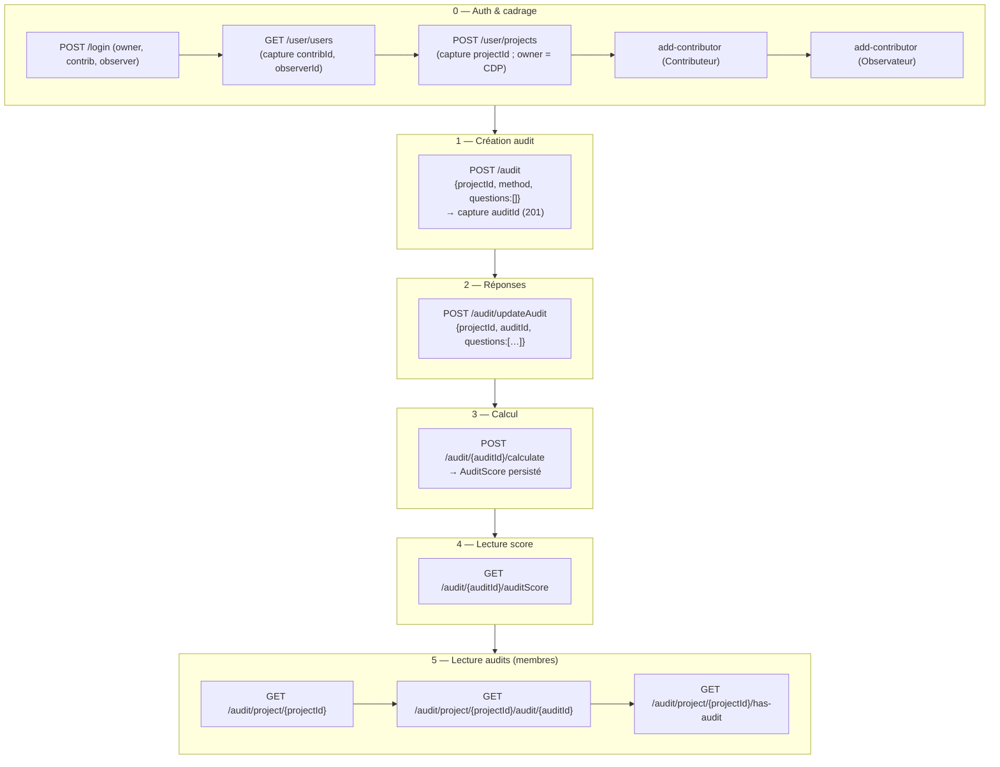
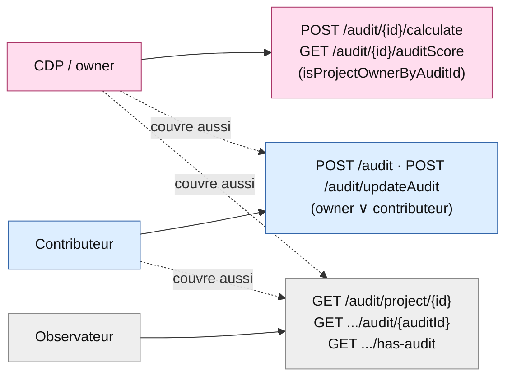
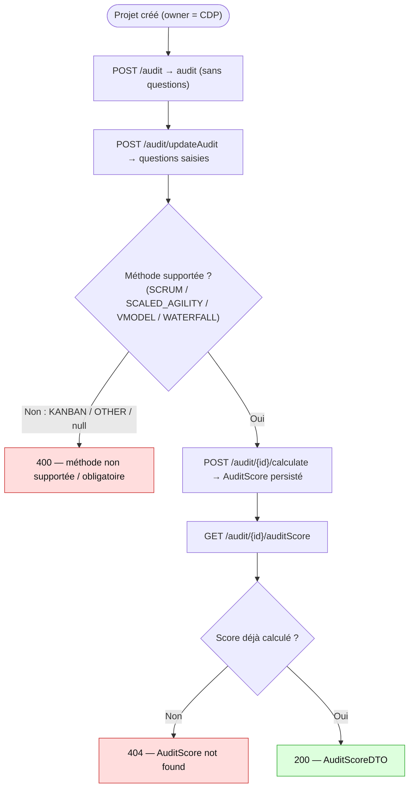
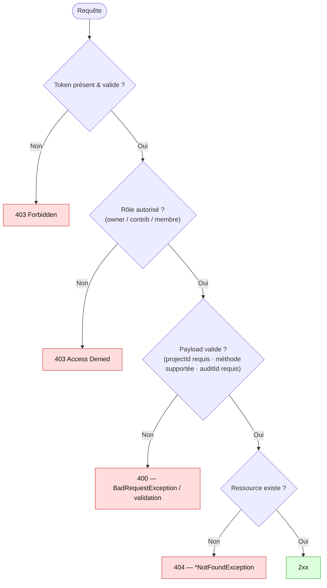

# ELIT Backend — Parcours Audit

> Document fonctionnel + technique du **parcours audit** (`com.elit.outildedecision.audit`).
> Objectif : comprendre l'**enchaînement des étapes**, les **dépendances d'ordre**, les **rôles**,
> les **cas d'erreur** et les **incohérences connues**. Les diagrammes sont en
> [Mermaid](https://mermaid.js.org/) (rendu natif GitHub / aperçu VSCode ; IntelliJ → plugin **Mermaid**).
>
> Périmètre : ce document décrit **uniquement le parcours audit** tel qu'il est réellement traité
> aujourd'hui (validé de bout en bout par la collection Postman *ELIT - Parcours Audit*).
> Les parcours **IA** (`ai/`) et **collaboratif** (`collaboration/`) ne sont pas couverts ici.
>
> Pour le contrat d'API complet, voir [ENDPOINTS_BACKEND.md](ENDPOINTS_BACKEND.md) §8.

---

## 1. Vue d'ensemble

Le parcours audit évalue la **maturité d'un projet sur une méthodologie** (Scrum, V-Model,
Waterfall, Scaled Agility) à partir d'un questionnaire pondéré, puis calcule un **score global et
par catégorie** enrichi de commentaires. Il se déroule en sous-parcours **ordonnés** autour du
calcul de score :

| # | Sous-parcours | Endpoint(s) | Rôle déclencheur | Précondition |
|---|---|---|---|---|
| 0 | Auth & cadrage projet | `shared/auth`, `shared/project` | CDP (owner) | — |
| 1 | Création de l'audit | `POST /audit` | CDP ∨ Contributeur | projet existant |
| 2 | Saisie des réponses | `POST /audit/updateAudit` | CDP ∨ Contributeur | audit créé |
| 3 | Calcul du score | `POST /audit/{auditId}/calculate` | CDP (owner) | méthode **supportée** |
| 4 | Lecture du score | `GET /audit/{auditId}/auditScore` | CDP (owner) | score **calculé** |
| 5 | Lecture des audits | `GET /audit/project/{projectId}` · `.../audit/{auditId}` · `.../has-audit` | membre du projet | projet existant |

**Rôles** (libellés FR exigés par le validateur et la sécurité) :
- **CDP / owner** : créateur du projet (`isProjectOwner`), permission stockée `CDP`.
- **Contributeur** : membre invité avec droits d'écriture (`isContributer`), permission `Contributeur`.
- **Observateur** : lecture seule (`isObserver`), permission `Observateur`.

> ⚠️ **Casse des rôles sensible.** `addProjectContributor` stocke le `role` **verbatim** comme
> permission, et la sécurité compare à `ProjectPermession.CONTRIBUTER/OBSERVER.toString()`
> (= `"Contributeur"` / `"Observateur"`). Il faut donc envoyer **exactement** `Contributeur` /
> `Observateur` (le `@Pattern` du DTO tolère la casse, mais la valeur stockée doit matcher le
> `toString()` pour que `isContributer`/`isObserver` la reconnaisse).

> **Méthodes supportées pour le calcul** : `SCRUM`, `SCALED_AGILITY`, `VMODEL`, `WATERFALL`
> (`AgilityScoringStrategy`). `KANBAN` et `OTHER` n'ont **aucune stratégie** → le calcul renvoie
> **400** (voir §4 et §5).

---

## 2. Flux nominal de bout en bout

> **`POST /audit` ignore les `questions` du payload** : seuls `method`, `project` et `user` sont
> persistés à la création. Les questions ne sont enregistrées que par `POST /audit/updateAudit`.
> Le contrat front (`{projectId, method, questions:[]}`) reste valide car le front crée avec
> `questions:[]` puis met à jour. La méthode est acceptée en **majuscules** en entrée
> (`MethodType.find` est insensible à la casse) et **ressort en minuscules** (`@JsonValue`, ex.
> `"scrum"`).

---

## 3. Rôles & sécurité par endpoint

Points notables :
- `POST /audit`, `POST /audit/updateAudit` : **owner ∨ Contributeur**
  (`isProjectOwner(#auditRequest.projectId) or isContributer(#auditRequest.projectId)`).
- `POST /audit/{auditId}/calculate`, `GET /audit/{auditId}/auditScore` : **owner uniquement**,
  résolu **par l'auditId** (`isProjectOwnerByAuditId`). Un audit **inconnu** → liste de permissions
  vide → **403** (la sécurité s'évalue **avant** l'existence ; pas de 404 ici).
- `GET /audit/project/{projectId}`, `.../audit/{auditId}`, `.../has-audit` : **membre du projet**
  (`isProjectOwner ∨ isContributer ∨ isObserver`). Un utilisateur authentifié **non-membre**
  (y compris un **ADMIN** non rattaché) est rejeté en **403** (durcissement, voir §4 et §6) — ces
  endpoints ne sont plus ouverts à tout le monde.

---

## 4. Dépendances d'ordre

> Le calcul exige une **méthode supportée** ; la lecture du score exige un **score déjà calculé**.

> **Limitations connues ouvertes** : aucune à l'instant T.
> Le calcul sur un audit **sans questions** est autorisé et renvoie un score `0.0` (choix produit
> assumé, pas une erreur).

### Commentaires : un référentiel, pas un sous-parcours

Les commentaires (`globalComment` au niveau global, `text`/`categoryCommentId` par catégorie) **ne
sont pas saisis** par l'utilisateur et **n'ont aucun endpoint REST** (CRUD). Ce sont des **données
de référence** stockées dans les tables `*_comment` (clé `method_type` + `level` [+ `category`]),
exposées en **lecture seule via les services `GlobalCommentService` / `CategoryCommentService`**.

Ils sont sélectionnés **automatiquement pendant le calcul** par `AuditCategoryResultEnricher` :
selon le `LevelScore` dérivé du pourcentage calculé (par catégorie et global), on récupère le texte
correspondant à la méthode et au niveau, puis on l'**embarque dans la réponse** de
`POST /audit/{id}/calculate` et `GET /audit/{id}/auditScore`. Il n'y a donc **rien à tester
isolément** : c'est un effet de bord du calcul, couvert par les assertions de score (§7).

> Tolérance à l'absence : un commentaire manquant (global ou par catégorie) **n'interrompt pas** le
> calcul — il ressort simplement `null` dans la réponse, le score restant valide. Le commentaire
> par catégorie l'a toujours été (`.orElse(null)`) ; le commentaire global l'est désormais aussi
> (correctif **D**, voir ci-dessous). En base `local` les tables sont seedées (le parcours Postman
> vérifie que `globalComment.text` et chaque `categoryComment.text` sont bien renseignés).

### Historique des correctifs

| Correctif | Commit |
|---|---|
| **A** — `GET /audit/project/{id}` & `/has-audit` : ajout du contrôle d'appartenance projet (`isProjectOwner ∨ isContributer ∨ isObserver`). Ces lectures étaient **totalement publiques** (`anyRequest().permitAll()` + aucun `@PreAuthorize`) → accès non authentifié aux audits de n'importe quel projet. Non-membre **200 → 403** | _ce commit_ |
| **B** — `POST /audit/{id}/calculate` sur méthode **non supportée** (`KANBAN`/`OTHER`) ou **absente** : `IllegalArgumentException`/`NullPointerException` → **500** remplacé par **400** (`BadRequestException`, message FR) | _ce commit_ |
| **C** — `POST /audit/updateAudit` sans `auditId` : `NullPointerException` (`Objects.requireNonNull`) → **500** remplacé par **400** (`BadRequestException`, message FR) | _ce commit_ |
| **D** — `POST /audit/{id}/calculate` sur une méthode **supportée mais sans commentaire global seedé** pour le niveau calculé : `findByMethodAndLevel().orElseThrow(IllegalArgumentException)` → **500**. Rendu **tolérant** (`orElse(null)`), aligné sur le commentaire par catégorie ; le score sort avec `globalComment: null` au lieu de planter | _ce commit_ |

---

## 5. Cas d'erreur (codes attendus)

Cas négatifs couverts par la collection Postman :

| Cas | Endpoint | Code |
|---|---|---|
| Lecture liste audits par non-membre (admin) | `GET /audit/project/{id}` | 403 |
| Lecture has-audit par non-membre (admin) | `GET /audit/project/{id}/has-audit` | 403 |
| Création audit par Observateur | `POST /audit` | 403 |
| Calcul par Contributeur (non-owner) | `POST /audit/{id}/calculate` | 403 |
| Lecture audit unitaire inexistant | `GET /audit/project/{id}/audit/999999` | 404 |
| Lecture score d'un audit inconnu | `GET /audit/999999/auditScore` | 403 |
| `updateAudit` sans `auditId` | `POST /audit/updateAudit` | 400 |
| Calcul sur méthode non supportée (KANBAN) | `POST /audit/{id}/calculate` | 400 |
| Création sans `projectId` | `POST /audit` | 400 |

---

## 6. Notes d'alignement front

### 6.1 Contrôle d'appartenance sur les lectures audit (Tier 2)

**Durcissement de sécurité.** Les lectures `GET /audit/project/{projectId}` et
`GET /audit/project/{projectId}/has-audit` n'avaient **aucun** `@PreAuthorize` et la configuration
de sécurité se termine par `anyRequest().permitAll()` : elles étaient donc **totalement publiques**
(accessibles **sans token**), permettant à quiconque d'énumérer les audits (nom/prénom du
créateur, méthode, totaux) de **n'importe quel projet** (IDOR / accès horizontal). Elles exigent
désormais d'être **membre du projet** (`isProjectOwner ∨ isContributer ∨ isObserver`), à l'image de
`GET /audit/project/{id}/audit/{auditId}` qui l'exigeait déjà.

**Impact front à vérifier** : pour un membre légitime, le happy-path reste **200** (inchangé). En
revanche, un utilisateur **non-membre** (y compris un compte **ADMIN** non rattaché au projet)
reçoit désormais **403** au lieu de 200. Tout écran qui appelait ces deux GET pour un projet non
rattaché à l'utilisateur courant doit gérer le 403. Le contrat OpenAPI (`api/`) est **inchangé**
(les réponses 401/403/404/500 sont déjà injectées globalement pour chaque opération).

### 6.2 `500 → 400` sur cas métier (calculate & updateAudit)

**Correctifs de robustesse (pas de changement du contrat happy-path).** Deux cas métier
renvoyaient une **500** générique (« An unexpected error occurred ») :
- `POST /audit/{auditId}/calculate` sur un audit dont la méthode est `KANBAN`/`OTHER` (aucune
  stratégie de scoring) ou `null` ;
- `POST /audit/updateAudit` sans `auditId`.

Ils renvoient désormais **400** avec un message FR explicite. Aucun écran ne devrait dépendre d'un
code 500 ; si du code front interceptait ce cas, le router sur 400 (erreur de saisie) plutôt que sur
une erreur serveur.

---

## 7. Couverture Postman (collection *ELIT - Parcours Audit*)

État : **25 requêtes / 38 assertions — 0 échec** (backend local, profil `local`, MySQL).

| Module | Couvert | Non couvert (raison) |
|---|---|---|
| Auth & cadrage | login ×4 (owner/contrib/observer/admin), GET users, create project, add-contributor ×2 | — |
| Création / réponses | POST /audit (201), POST /audit/updateAudit (200, 2 questions) | — |
| Calcul / score | POST calculate (200, score + **commentaires global & par catégorie non vides**), GET auditScore (200, **globalComment non vide**) | CRUD commentaires : **aucun endpoint** (référentiel auto-injecté, cf. §4) |
| Lecture audits | GET liste, GET unitaire (par Observateur), GET has-audit | — |
| Cas négatifs | 403 (non-membre ×2, rôle écriture, owner-only), 404 (audit inconnu), 403 (score audit inconnu), 400 (updateAudit sans auditId, KANBAN non supporté, projectId manquant) | — |

> La collection est **auto-suffisante** : elle s'appuie sur les comptes démo seedés
> (`DemoDataSeeder`, mot de passe `Azerty1234!?`) et construit son propre état (capture de
> `contribId`/`observerId`/`projectId`/`auditId`/`kanbanAuditId`). Aucun id en dur ; rejouable sur
> une base fraîche.
