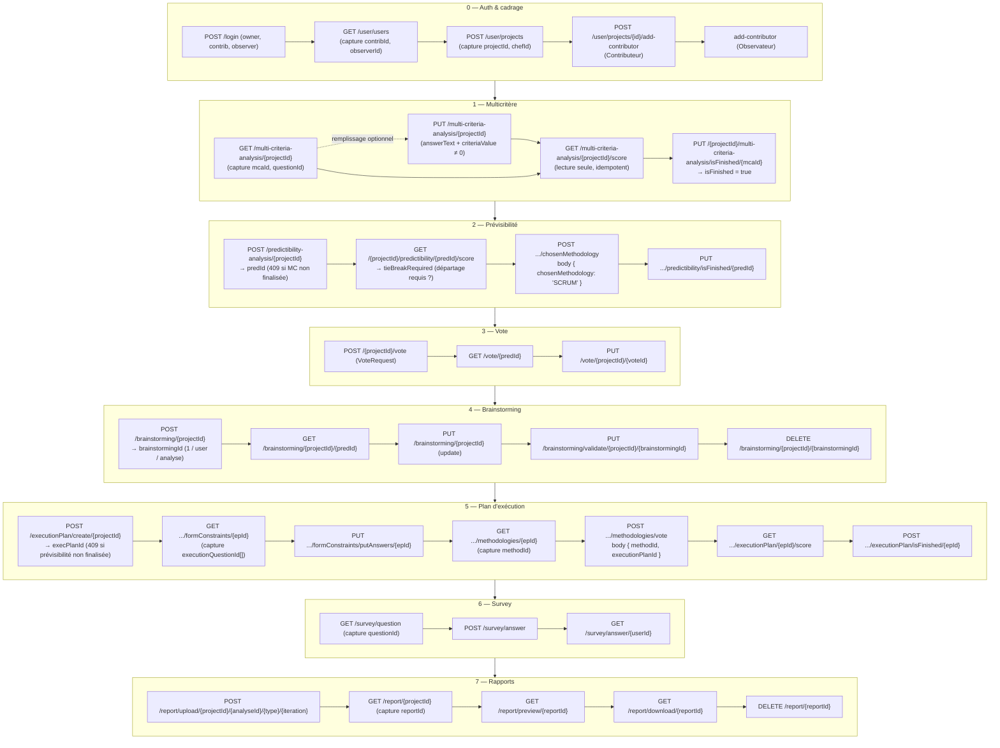
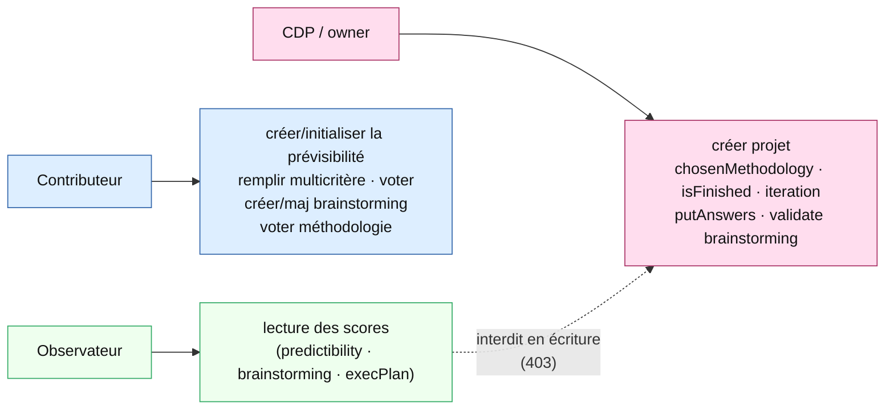
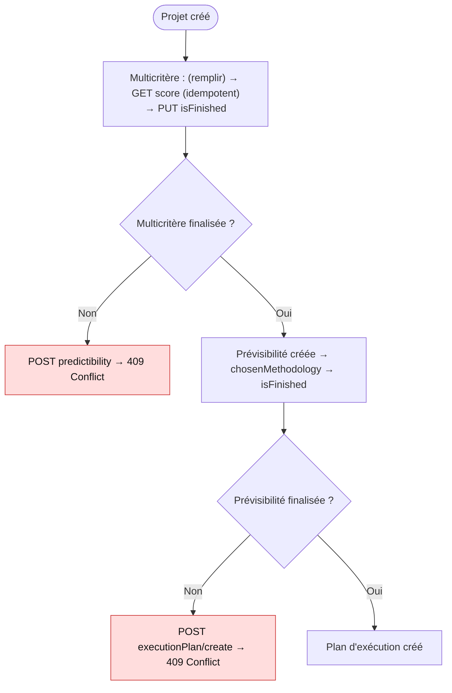
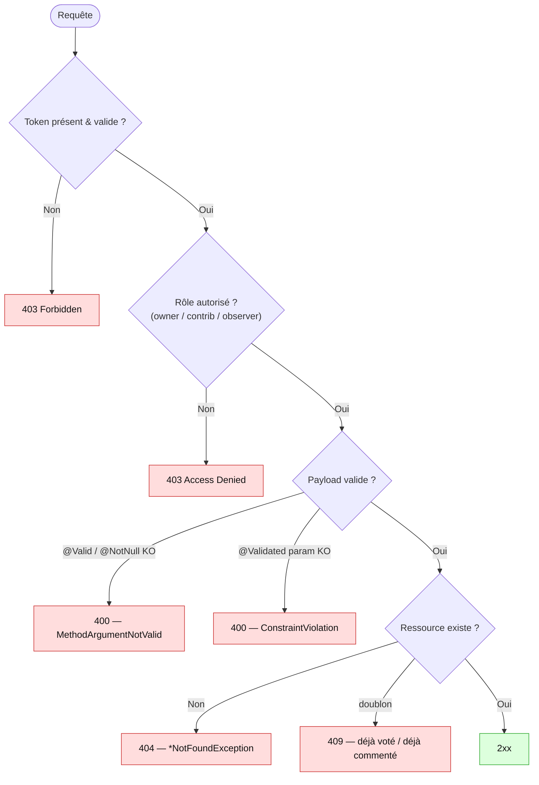

# ELIT Backend — Parcours Collaboratif

> Document fonctionnel + technique du **parcours collaboratif** (`com.elit.outildedecision.collaboration`).
> Objectif : comprendre l'**enchaînement des étapes**, les **dépendances d'ordre**, les **rôles**,
> les **cas d'erreur** et les **incohérences connues**. Les diagrammes sont en
> [Mermaid](https://mermaid.js.org/) (rendu natif GitHub / aperçu VSCode ; IntelliJ → plugin **Mermaid**).
>
> Périmètre : ce document décrit **uniquement le parcours collaboratif** tel qu'il est réellement
> traité aujourd'hui (validé de bout en bout par la collection Postman *ELIT - Parcours Collaboratif*).
> Les parcours **IA** (`ai/`) et **audit** (`audit/`) ne sont pas couverts ici.
>
> Pour le contrat d'API complet, voir [ENDPOINTS_BACKEND.md](ENDPOINTS_BACKEND.md).
> Pour les règles de calcul, voir [REGLES_CALCUL_METIER.md](REGLES_CALCUL_METIER.md).

---

## 1. Vue d'ensemble

Le parcours collaboratif accompagne une équipe projet dans le **choix d'une méthodologie de gestion
de projet** (Scrum, Kanban, XP, …) puis dans la **construction d'un plan d'exécution**. Il se déroule
en 8 sous-parcours **ordonnés** :

| # | Sous-parcours | Feature | Rôle déclencheur |
|---|---|---|---|
| 0 | Auth & cadrage projet | `shared/auth`, `shared/project` | CDP (owner) |
| 1 | Analyse multicritère | `multicriteria` | Contributeur |
| 2 | Analyse de prévisibilité | `predictibility` | CDP + Contributeur |
| 3 | Vote (prévisibilité) | `vote` | Contributeur |
| 4 | Brainstorming | `brainstorming` | Contributeur |
| 5 | Plan d'exécution | `executionplan` | CDP + Contributeur |
| 6 | Questionnaire (survey) | `survey` | Tout utilisateur |
| 7 | Rapports | `report` | CDP |

**Rôles** (libellés FR exigés par le validateur et la sécurité) :
- **CDP / owner** : créateur du projet (`isProjectOwner`).
- **Contributeur** : membre invité avec droits d'écriture (`isContributer`).
- **Observateur** : lecture seule (`isObserver`).

---

## 2. Flux nominal de bout en bout

> ⚠️ L'enchaînement n'est **pas** purement libre : plusieurs étapes ne se débloquent que si la
> précédente a été **finalisée**. Ces dépendances sont implicites (aucune n'est documentée dans le
> contrat) — voir §4.

---

## 3. Rôles & sécurité par endpoint

Points notables :
- `predictibility/score`, `executionPlan/score`, `brainstorming GET` : ouverts à **ADMIN ∨ Contributeur ∨ Observateur**.
- `chosenMethodology`, `isFinished`, `putAnswers`, `validate brainstorming` : **owner uniquement**.
- **Création de prévisibilité** (`POST /predictibility-analysis/{projectId}`), vote (prévisibilité
  **et** méthodologie), remplissage multicritère, création brainstorming : **Contributeur** (owner
  inclus). Le vote méthodologie est **parallèle** : un contributeur initialise l'analyse de
  prévisibilité lui-même et vote sans attendre l'owner — l'appel est idempotent (renvoie l'analyse
  existante).

---

## 4. Dépendances d'ordre

> Le parcours a des **dépendances d'ordre** : certaines étapes ne se débloquent que si la précédente
> a été **finalisée**. Les préconditions non remplies renvoient des codes explicites (409).

> Aucune limitation/incohérence connue ouverte à l'instant T sur ce parcours.

### Départage de méthodologie (`tieBreakRequired`)

Le score de prévisibilité auto-sélectionne la méthodologie gagnante (cumul de votes le plus élevé,
départage interne par ordre de déclaration de l'enum). Quand **deux méthodologies sont à égalité au
sommet** et que l'owner n'a pas encore tranché (`chosenMethodology == null`), `GET .../score` renvoie
`tieBreakRequired = true`. Le front s'appuie sur ce seul booléen pour **griser le bouton « Compléter
le formulaire » de l'étape 3** tant que l'égalité n'est pas résolue. Après `POST .../chosenMethodology`
(owner), un nouveau `GET .../score` renvoie `tieBreakRequired = false`. Sans vote confirmé, le flag
reste `false` (l'égalité n'a de sens que sur des votes réels).

Quand l'owner tranche, son choix (`chosenMethodology`) prime sur l'auto-pick : au recalcul du score,
l'association `methodology` est alignée sur le choix manuel et **non** sur la méthodologie déduite par
ordre de déclaration. Sans cela, l'étape 3 (`loadScorableMethods` dans `ExecutionPlanServiceImpl`)
calculerait le plan d'exécution sur une autre méthodologie que celle choisie en cas d'égalité.

### Historique des correctifs

| Correctif | Commit |
|---|---|
| `GET /multi-criteria-analysis/{id}` 500 → init du graphe lazy hors transaction | `4d93eff` |
| Survey réponse vide 500 → 400 (`ConstraintViolationException` mappée) | `a1e32d6` |
| Stabilisation Tier 1 : exec plan create 500 → 404/409, garde-fous null, brainstorming valide l'appartenance de la question | `770f6ec`, `3b7d36d`, `db37f54` |
| `chosenMethodology` : parsing JSON manuel → DTO `@Valid` (JSON inchangé) | `a059689` |
| `POST predictibility` : sentinelle `-1`/403 → `409 Conflict` | `a584480` |
| `GET multi-criteria score` rendu idempotent + endpoint explicite `PUT isFinished` | `7668ccc` |
| brainstorming `create` renvoie l'`id` → `update`/`validate`/`delete` outillables | `3ee114e` |
| `POST executionPlan/create` : 409 exige désormais une prévisibilité **finalisée** (et non juste existante) | _antérieur_ |
| Création de prévisibilité ouverte au Contributeur (`isProjectOwner` → `isContributer`) : vote méthodologie parallèle, plus d'attente du créateur (loader infini côté contributeur) | _antérieur_ |
| `tieBreakRequired` exposé sur `GET .../score` (égalité de méthodologie non départagée → bouton étape 3 grisé côté front) | _ce commit_ |
| `GET .../score` 500 (NPE) quand un `FormStep.eScore` est `null` → traité comme `0` | _ce commit_ |
| Égalité tranchée : `chosenMethodology` (choix owner) aligné sur l'association `methodology` au recalcul du score → l'étape 3 calcule le plan sur la bonne méthodologie | _ce commit_ |

---

## 5. Cas d'erreur (codes attendus)

Cas négatifs couverts par la collection Postman :

| Cas | Endpoint | Code |
|---|---|---|
| Création prévisibilité par Observateur | `POST /predictibility-analysis/{id}` | 403 |
| Score sur id inexistant | `GET /{id}/predictibility/999999/score` | 404 |
| Vote en doublon | `POST /{id}/vote` (2ᵉ fois) | 409 |
| Vote sans `predictibilityAnalysisId` | `POST /{id}/vote` | 400 |
| Vote sans token | `POST /{id}/vote` | 403 |
| Brainstorming par Observateur | `POST /brainstorming/{id}` | 403 |
| Réponse survey vide | `POST /survey/answer` | 400 |

---

## 6. Brainstorming — cycle de vie complet

`POST /brainstorming/{projectId}` renvoie le **`brainstormingId`** créé, ce qui permet d'outiller les
trois mutations qui en dépendent (`brainstormingRepository.findById`) :

- `PUT /brainstorming/{projectId}` — mise à jour (Contributeur **auteur** du commentaire)
- `PUT /brainstorming/validate/{projectId}/{brainstormingId}` — validation (owner, body `{ "isConfirmed": true }`)
- `DELETE /brainstorming/{projectId}/{brainstormingId}` — suppression (owner ou Contributeur)

Contraintes : **1 commentaire par utilisateur / question / analyse** ; la création valide que le
`questionId` appartient bien à l'analyse du projet (sinon `404`/`400`).

---

## 7. Couverture Postman (collection *ELIT - Parcours Collaboratif*)

État : **59 requêtes / 66 assertions — 0 échec**. Couverture des endpoints du contexte `collaboration` :

| Module | Couvert | Non couvert (raison) |
|---|---|---|
| Multi-criteria | GET analysis, GET score, **isFinished**, PUT iteration | PUT update step / question (*remplissage dynamique multi-steps, non bloquant*) |
| Predictibility | create, score (+ `tieBreakRequired`), chosenMethodology, isFinished, iteration | — |
| Vote | create, get, update | — |
| Brainstorming | create, get, abstract, **update, validate, delete** | — |
| Execution Plan | create, formConstraints, putAnswers, methodologies, vote, score, isFinished | — |
| Survey | question, answer, getAnswers | — |
| Report | upload, list, preview, download, delete | PUT update (*multipart redondant avec upload*) |

> Le folder `08 - Iterations (post-flux)` (itération multicritère) est volontairement **en fin de run** :
> l'itération ré-ouvre l'analyse multicritère (`isFinished=false`), l'insérer dans la chaîne ferait
> échouer la création de prévisibilité en aval (**409**).
>
> Le folder `09 - Tie break (regression)` est **auto-suffisant** (projet + analyses dédiés) : il
> reproduit le ticket d'égalité (owner vote *Agile* 3 / contributeur vote *Hybride* 3), asserte
> `tieBreakRequired === true` tant que l'owner n'a pas tranché, puis `=== false` après
> `POST .../chosenMethodology`. Il calcule le score multicritère avant de finaliser (sinon
> `FormStep.eScore` reste `null` — cf. correctif §4).
