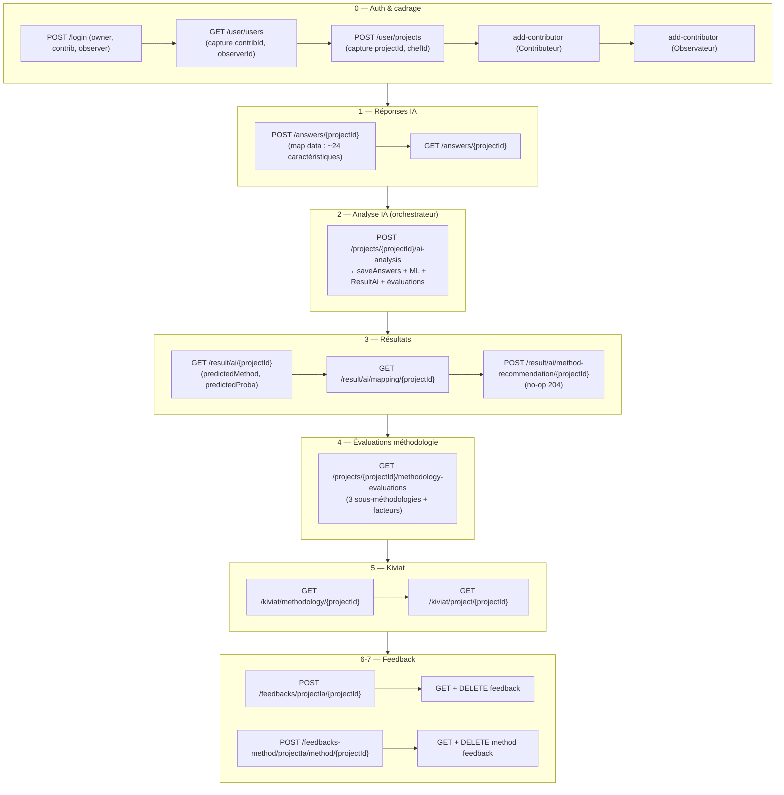
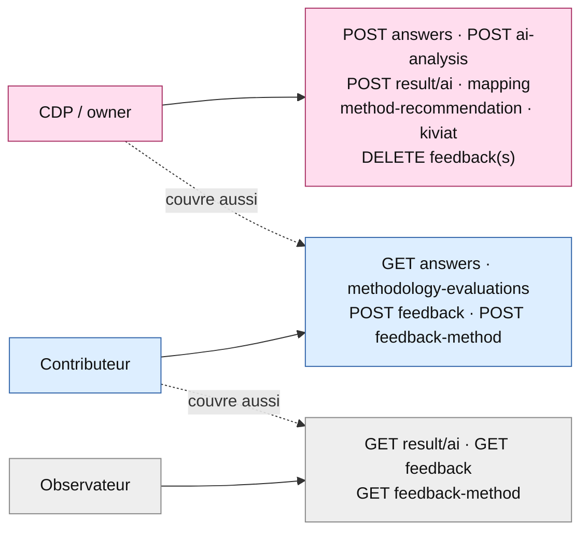
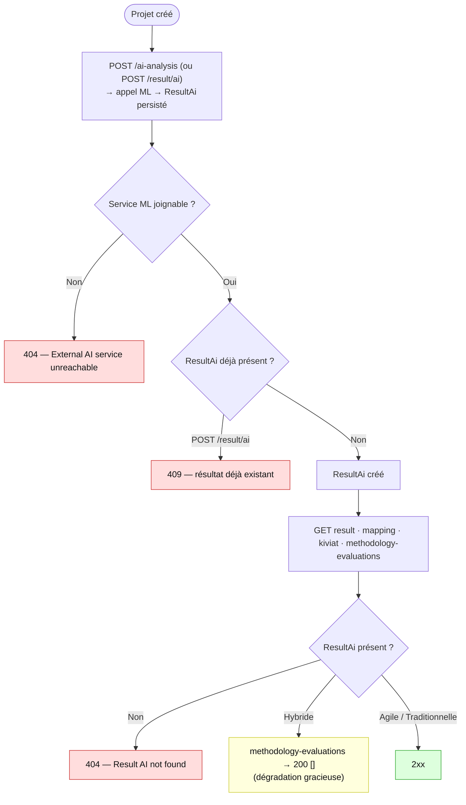
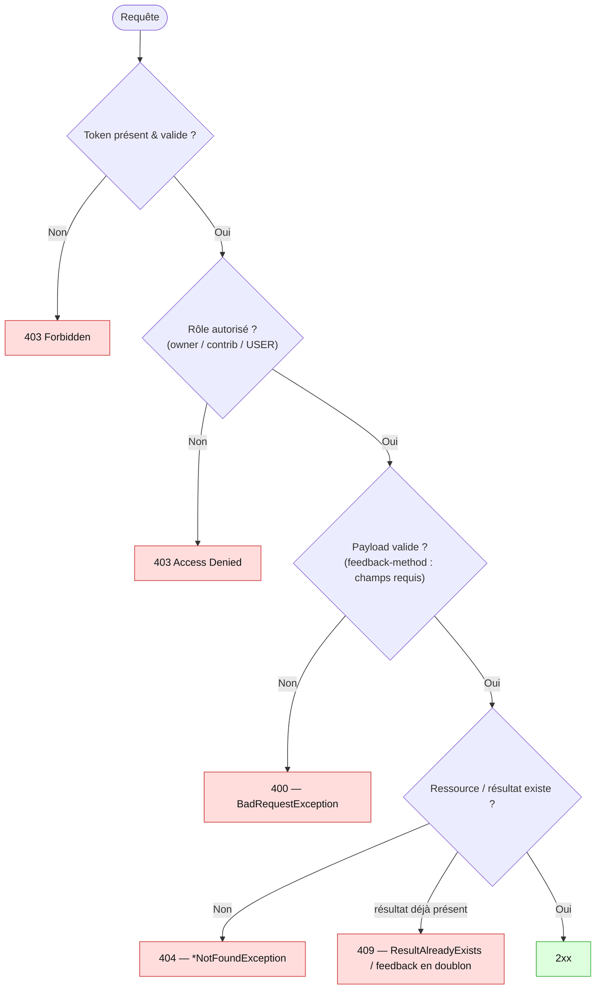

# ELIT Backend — Parcours IA

> Document fonctionnel + technique du **parcours IA** (`com.elit.outildedecision.ai`).
> Objectif : comprendre l'**enchaînement des étapes**, les **dépendances d'ordre**, les **rôles**,
> les **cas d'erreur** et les **incohérences connues**. Les diagrammes sont en
> [Mermaid](https://mermaid.js.org/) (rendu natif GitHub / aperçu VSCode ; IntelliJ → plugin **Mermaid**).
>
> Périmètre : ce document décrit **uniquement le parcours IA** tel qu'il est réellement traité
> aujourd'hui (validé de bout en bout par la collection Postman *ELIT - Parcours IA*).
> Les parcours **collaboratif** (`collaboration/`) et **audit** (`audit/`) ne sont pas couverts ici.
>
> Pour le contrat d'API complet, voir [ENDPOINTS_BACKEND.md](ENDPOINTS_BACKEND.md).

---

## 1. Vue d'ensemble

Le parcours IA recommande une **méthodologie de gestion de projet** à partir d'un questionnaire
projet (~24 caractéristiques), via un **service ML externe** (PMM prediction). Il se déroule en
sous-parcours **ordonnés** autour d'un appel central d'analyse :

| # | Sous-parcours | Feature | Rôle déclencheur | Dépend du ML externe |
|---|---|---|---|---|
| 0 | Auth & cadrage projet | `shared/auth`, `shared/project` | CDP (owner) | non |
| 1 | Réponses IA | `answer` | CDP | non |
| 2 | Analyse IA (orchestrateur) | `analysis` | CDP | **oui** |
| 3 | Résultats & recommandations | `result` | CDP / membres | non (lit le stocké) |
| 4 | Évaluations méthodologie | `methodology/evaluation` | CDP + Contributeur | non (lit le stocké) |
| 5 | Kiviat (radar) | `kiviat` | CDP | non (lit le stocké) |
| 6 | Feedback recommandation | `feedback` | CDP + Contributeur | non |
| 7 | Feedback méthodologie | `feedback` | CDP + Contributeur | non |

**Rôles** (libellés FR exigés par le validateur et la sécurité) :
- **CDP / owner** : créateur du projet (`isProjectOwner`).
- **Contributeur** : membre invité avec droits d'écriture (`isContributer`).
- **Observateur** : lecture seule (`isObserver`).

> **Service ML externe** : configuré via `ia.prediction.api.base.url` (`AI_API_URL_INTEG`).
> En local il tourne sur `http://localhost:8090/api/` (`/api/process_predict` = famille
> Agile/Traditionnelle/Hybride ; `/api/process_predict_rf` = sous-méthodologies, exige `model_type`).
> Le backend **forwarde tel quel** la map `data` du questionnaire : les clés/valeurs doivent
> respecter le schéma attendu par le modèle, sinon le service renvoie **422**.
>
> ⚠️ **Clés/valeurs sensibles à la casse et aux espaces** : certaines valeurs d'encodage du modèle
> contiennent des espaces ou une casse précise non normalisés côté IA — elles doivent être envoyées
> **à l'identique**, par exemple `" > every 4 weeks"` (espace de tête), `">10 m€"`, `"> 24"`,
> `"100,000 to 1m€"`. Une valeur mal cassée/espacée n'est pas reconnue (non géré côté IA).

---

## 2. Flux nominal de bout en bout

> **`POST /result/ai/{projectId}`** est une variante granulaire de l'analyse (génère + persiste le
> seul `ResultAi`, sans les évaluations de méthodologie). L'orchestrateur `ai-analysis` est le chemin
> nominal ; appeler `POST /result/ai` ensuite renvoie **409** (résultat déjà présent).

---

## 3. Rôles & sécurité par endpoint

Points notables :
- `POST /answers`, `POST /ai-analysis`, `POST /result/ai`, `mapping`, `method-recommendation`,
  `kiviat`, `DELETE feedback` : **owner uniquement** (`isProjectOwner`).
- `GET /answers`, `GET /methodology-evaluations`, `POST /feedbacks`, `POST /feedbacks-method` :
  **owner ∨ Contributeur** (`isContributer`).
- `GET /result/ai`, `GET /feedbacks`, `GET /feedbacks-method` : **membres du projet**
  (`isContributer(#projectId) or isObserver(#projectId)`, soit CDP ∨ Contributeur ∨ Observateur).
  Un utilisateur authentifié **non-membre** est rejeté en **403** (durcissement, voir §4 et §6) —
  ces endpoints ne sont plus ouverts à tout porteur d'`USER`.

---

## 4. Dépendances d'ordre

> Tout le côté lecture du parcours (résultats, mapping, évaluations, kiviat) ne renvoie des données
> qu'une fois un `ResultAi` **persisté** par l'analyse. Sans analyse préalable → **404**.

> **Limitations connues ouvertes** : aucune à l'instant T.
> Les projets de famille **Hybride** n'ont pas d'évaluation de sous-méthodologie ni de réponse
> `process_predict_rf` : `GET /methodology-evaluations` renvoie alors **`200 []`** (choix produit
> assumé, pas une erreur).

### Historique des correctifs

| Correctif | Commit |
|---|---|
| `POST /result/ai` & `POST /ai-analysis` : résultat déjà existant **401 → 409 Conflict** (code cohérent avec le message « already exists ») | _ce commit_ |
| `GET /result/ai`, `/feedbacks/projectIa`, `/feedbacks-method/projectIa/method` : `hasAnyAuthority('USER')` → **contrôle d'appartenance projet** (`isContributer ∨ isObserver`) ; non-membre **200 → 403**, projet hors-périmètre **404 → 403** | _ce commit_ |
| `POST /ai-analysis` (projet **Hybride**) : `500 → 200`. `createEvaluation` levait `UnsupportedModelTypeException` dans la transaction partagée → `rollback-only` → `UnexpectedRollbackException` au commit malgré le `catch`. Ajout de `noRollbackFor` → la dégradation gracieuse fonctionne enfin | _ce commit_ |

---

## 5. Cas d'erreur (codes attendus)

Cas négatifs couverts par la collection Postman :

| Cas | Endpoint | Code |
|---|---|---|
| Sauvegarde réponses par Observateur | `POST /answers/{id}` | 403 |
| Lecture résultat par Observateur (membre) | `GET /result/ai/{id}` | 200 |
| Lecture résultat projet hors-périmètre / non-membre | `GET /result/ai/999999` | 403 |
| Feedback méthodo sans `methodName` | `POST /feedbacks-method/projectIa/method/{id}` | 400 |
| Re-génération de résultat | `POST /result/ai/{id}` (résultat présent) | 409 |
| Feedback recommandation en doublon | `POST /feedbacks/projectIa/{id}` (2ᵉ fois) | 409 |

---

## 6. Notes d'alignement front

### 6.1 `401 → 409` (POST result/ai & ai-analysis)

**Changement de contrat (Tier 2).** Quand un résultat IA existe déjà pour le projet,
`POST /result/ai/{projectId}` et `POST /projects/{projectId}/ai-analysis` renvoyaient
historiquement **401 Unauthorized** (`{"status":401,"message":"AI analysis result already exists for
this project."}`). Le statut est désormais **409 Conflict**, sans changement du corps autre que le
champ `status`.

**Impact front à vérifier** : tout code front qui traitait ce cas en interceptant un **401**
(typiquement une logique de redirection vers la reconnexion / refresh token) doit désormais router
ce cas sur **409** comme un conflit métier (« analyse déjà réalisée »), pas comme une perte de
session. Le message reste identique.

### 6.2 Contrôle d'appartenance sur les lectures (GET result / feedbacks / feedbacks-method)

**Durcissement de sécurité.** Les lectures `GET /result/ai/{projectId}`,
`GET /feedbacks/projectIa/{projectId}/{userId}` et
`GET /feedbacks-method/projectIa/method/{projectId}[/{userId}/{methodName}]` étaient ouvertes à
**tout utilisateur authentifié** (`hasAnyAuthority('USER')`) : n'importe qui pouvait lire le
résultat IA ou les feedbacks d'un projet **dont il n'est pas membre** (accès horizontal / IDOR).
Elles exigent désormais d'être **membre du projet** (`isContributer ∨ isObserver`, soit CDP,
Contributeur ou Observateur).

**Impact front à vérifier** : pour un membre légitime le happy-path reste **200** (inchangé). En
revanche un utilisateur **non-membre** reçoit désormais **403** (au lieu de 200), et l'accès à un
**projet inexistant / hors-périmètre** renvoie **403** (au lieu de 404 — on ne révèle plus
l'existence du projet). Tout écran qui appelait ces GET pour un projet non rattaché à l'utilisateur
doit gérer le 403.

---

## 7. Couverture Postman (collection *ELIT - Parcours IA*)

État : **33 requêtes / 40 assertions — 0 échec** (backend local + service ML sur `localhost:8090`).

| Module | Couvert | Non couvert (raison) |
|---|---|---|
| Answer | POST save, GET | — |
| Analysis | POST ai-analysis (orchestrateur) | — |
| Result | GET result, GET mapping, method-recommendation (204), 409 doublon | — |
| Methodology eval | GET evaluations (Traditionnelle) + **branche Hybride `200 []`** (folder 09, projet dédié) | — |
| Kiviat | GET methodology, GET project | — |
| Feedback (recommandation) | POST, GET, DELETE, 409 doublon | — |
| Feedback (méthodologie) | POST, GET (liste + unitaire), DELETE | — |
| Cas négatifs | 403 (rôle écriture), 403 (non-membre en lecture), 400 (validation) | — |

> Le payload `data` du questionnaire est calibré pour prédire **Traditionnelle** (→ `model_type`
> *traditional*, supporté par `process_predict_rf`), ce qui rend déterministes les étapes aval
> (résultat, évaluations, kiviat). Le folder **09** utilise un second payload calibré pour prédire
> **Hybride** (projet dédié) afin de couvrir la dégradation gracieuse `methodology-evaluations → 200 []`.
> Les valeurs des deux payloads suivent strictement les clés d'encodage du modèle ML (sensibles à la
> casse et aux espaces, ex. `" > every 4 weeks"`) ; une valeur non reconnue n'est pas gérée côté IA.
