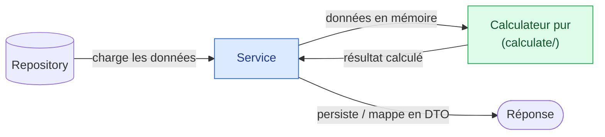
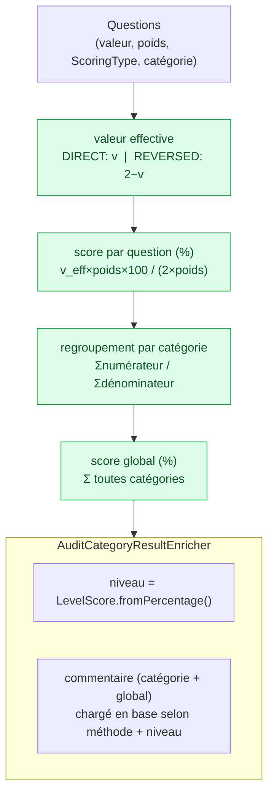
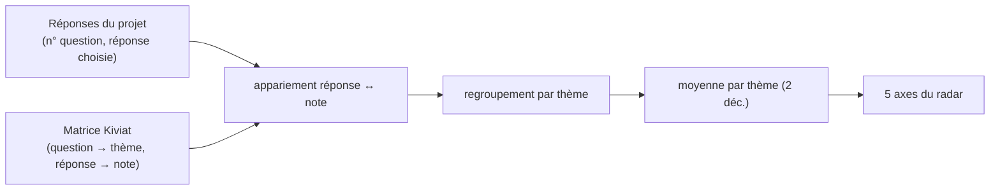
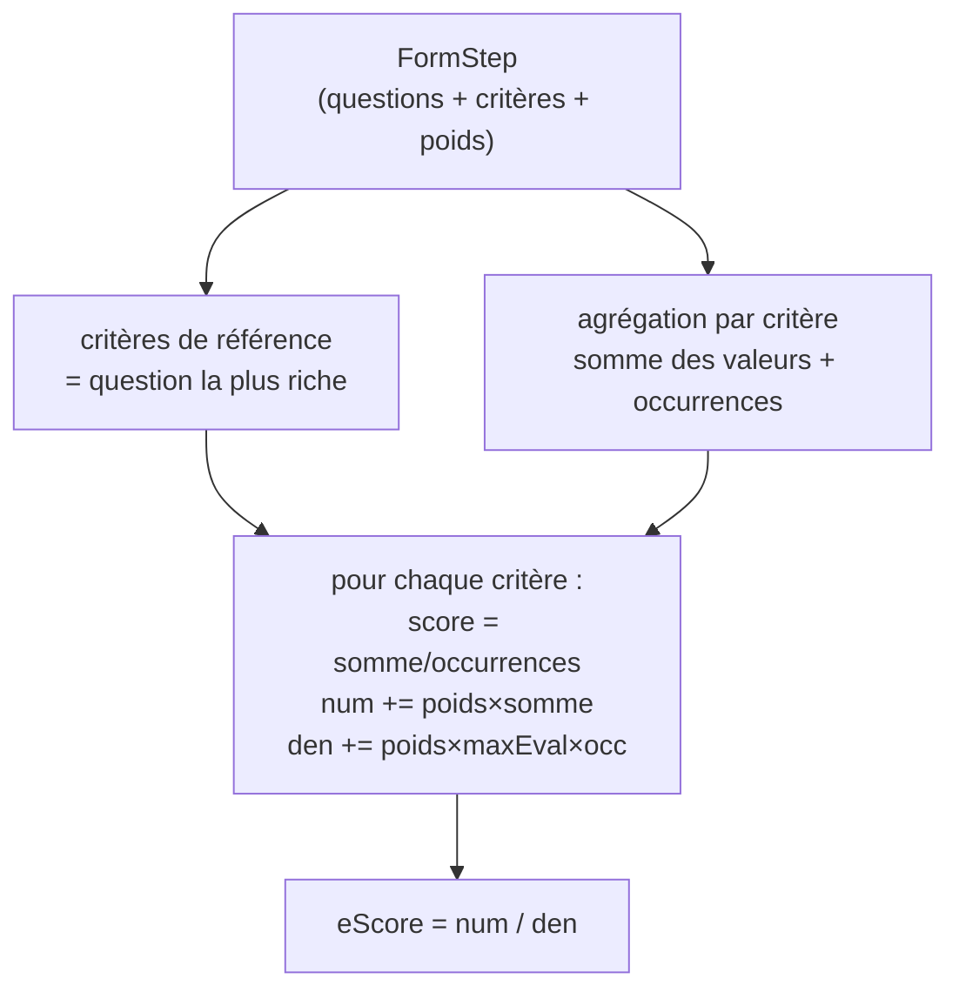

# ELIT Backend — Règles de calcul métier par composant

> Document d'onboarding. Objectif : comprendre **comment l'application calcule ses scores**,
> parcours par parcours, sans avoir à lire le code. Les formules sont vulgarisées et illustrées.
> Les diagrammes sont en [Mermaid](https://mermaid.js.org/) (rendu natif GitHub + aperçu VSCode).
> Sur **IntelliJ IDEA**, installez le plugin **Mermaid** (Settings → Plugins → Marketplace) pour
> voir les diagrammes dans l'aperçu Markdown.
>
> Pour l'architecture générale, voir [ARCHITECTURE_OVERVIEW.md](ARCHITECTURE_OVERVIEW.md).
> Pour le contrat d'API, voir [ENDPOINTS_BACKEND.md](ENDPOINTS_BACKEND.md).

---

## 0. Le principe commun à tous les calculs

Tout le calcul métier vit dans des **calculateurs purs** placés dans un package `<feature>/calculate/`.
La règle est toujours la même :



- **Le service orchestre** : il charge (repository), appelle le calculateur, puis persiste ou mappe.
- **Le calculateur est pur et sans état** : pas d'accès base, pas d'injection de repository. Il reçoit
  des objets déjà chargés et renvoie un résultat. C'est ce qui le rend testable en isolation.

Trois parcours portent des règles de calcul : **Audit**, **IA** et **Collaboration**.

---

## 1. Parcours Audit — score d'agilité d'un questionnaire

**Où :** `audit/calculate/`
**Composants :** `ScoringStrategyFactory`, `AgilityScoringStrategy` (implémente `MethodsScoringStrategy`),
`AuditCategoryResultEnricher`, plus les enums `ScoringType` et `LevelScore`.

### 1.1 Le principe

Un audit est un **questionnaire**. Chaque question :
- appartient à une **catégorie** (`QuestionCategory` : Organisations, Objectif & périmètres, Planification
  & ressources, Suivi Risque & changement, Outils & documentation, Communication et collaboration) ;
- a une **réponse** (valeur 0, 1 ou 2) et un **poids** (`weight`) ;
- a un **sens de notation** (`ScoringType`) : `DIRECT` ou `REVERSED`.

On calcule un **pourcentage par question**, puis **par catégorie**, puis un **score global**.

### 1.2 La sélection de la stratégie

`ScoringStrategyFactory` choisit la stratégie selon le `MethodType` de l'audit (Scrum, Safe/Scaled,
V-Model, Waterfall…). Aujourd'hui une seule stratégie, `AgilityScoringStrategy`, couvre
`SCRUM`, `SCALED_AGILITY`, `VMODEL` et `WATERFALL`. La factory est un simple **registre** `MethodType → stratégie`
construit au démarrage ; demander un type non couvert lève une `IllegalArgumentException`.

> Ce point d'extension permet d'ajouter une stratégie de notation différente (ex. Kanban) sans toucher
> au reste : il suffit d'implémenter `MethodsScoringStrategy` et de déclarer ses `supportedTypes()`.

### 1.3 Les formules, étape par étape

**a) Valeur effective de la réponse** (`ScoringType`) — gère les questions « inversées » :

| ScoringType | Formule | Idée |
|---|---|---|
| `DIRECT`   | `valeur` | la bonne réponse vaut le maximum (2) |
| `REVERSED` | `2 − valeur` | la réponse est posée à l'envers, on retourne l'échelle |

**b) Score d'une question** (en %) :

```
scoreQuestion = (valeurEffective × poids × 100) / maxPossible
   avec  maxPossible = 2 × poids        (la réponse max vaut 2)
```

Si `maxPossible = 0` (poids nul), le score vaut `0`. Le résultat est arrondi à l'entier.

**c) Score d'une catégorie** — on **somme** sur toutes les questions de la catégorie, puis on rapporte :

```
scoreCatégorie = ( Σ (valeurEffective × poids) × 100 ) / Σ (2 × poids)
```

**d) Score global** — même formule mais sur **toutes** les questions de l'audit (somme des numérateurs /
somme des dénominateurs de toutes les catégories). C'est une moyenne pondérée par les poids, pas une
moyenne des pourcentages de catégorie.



### 1.4 L'enrichissement (niveau + commentaires)

Une fois les pourcentages calculés, `AuditCategoryResultEnricher` traduit chaque score en **niveau**
qualitatif via `LevelScore.fromPercentage()` :

| Pourcentage | Niveau |
|---|---|
| `> 80` | `BON` |
| `> 40` et `≤ 80` | `MOYEN` |
| `≤ 40` | `MAUVAIS` |

Puis il va chercher en base le **commentaire** correspondant (par catégorie + niveau, et un commentaire
global par méthode + niveau). C'est le seul composant du parcours qui touche la base — il est volontairement
séparé du calcul pur.

---

## 2. Parcours IA — radar Kiviat & sélection des évaluations

**Où :** `ai/kiviat/calculate/` et `ai/methodology/evaluation/calculate/`

### 2.1 KiviatScoreCalculator — le radar à 5 axes

Le Kiviat est un **graphe radar** à 5 axes (`KiviatTheme`) :
`FlexibiliteGestion`, `FlexibiliteSolution`, `ConfianceEtDelegation`, `MaitrisePerimetre`, `Coordination`.

Principe : chaque question de la matrice porte un **thème** ; chaque réponse possible porte une **note**.
Pour les réponses du projet, on regroupe les notes par thème et on fait la **moyenne**.

```
scoreAxe = moyenne(notes des réponses de ce thème), arrondi à 2 décimales
        = 0.0 si le thème n'a aucune réponse
```



> Détail important : la note remontée dépend de la **réponse choisie** (matchée par son id), pas de la
> simple présence de la question. Un thème sans réponse correspondante reste à `0.0` (pas d'exclusion).

### 2.2 MethodologyEvaluationSelector — garder le meilleur

L'IA externe renvoie une liste d'**évaluations de méthodologies**, déjà triées par score décroissant,
chacune avec ses **facteurs explicatifs**. Ce composant ne calcule pas de score : il **élague** pour ne
garder que l'essentiel à afficher :

- on garde au plus **3 évaluations** (les mieux notées, l'ordre amont est respecté) ;
- dans chacune, on garde les **N facteurs** au plus fort `questionScore`, triés décroissant
  (`N = maxFactors`, passé par le service).

---

## 3. Parcours Collaboration — votes & scores d'atelier

Trois calculateurs indépendants, un par sous-feature. Tous suivent le même schéma « agréger en mémoire
puis désigner un gagnant ».

### 3.1 MultiCriteriaScoreCalculator — l'eScore d'une étape

**Où :** `collaboration/multicriteria/calculate/`

Une **étape de formulaire** contient des questions ; chaque question porte des **critères** (nom + valeur)
et l'étape porte des **pondérations** (`StepWeight`, un poids par nom de critère).

Étapes du calcul :

1. **Critères de référence** = ceux de la question qui en porte **le plus** (certaines questions sautent
   volontairement un critère). C'est l'ensemble de critères servant de base.
2. Pour chaque critère, on **somme** ses valeurs sur toutes les questions et on compte ses **occurrences**.
3. **Score par critère** = `sommeValeurs / occurrences` (moyenne brute).
4. **eScore de l'étape** = ratio pondéré :

```
eScore = Σ (poids × sommeValeurs)  /  Σ (poids × maxEval × occurrences)
```

où `maxEval` est la valeur max qu'un critère peut atteindre (paramètre `maxAllowedEvaluation`).
Si le dénominateur vaut `0`, une `EscoreException` est levée (un eScore n'a alors pas de sens).



### 3.2 MethodologyScoreCalculator — prédictibilité (votes pondérés)

**Où :** `collaboration/predictibility/calculate/`

À partir des **votes confirmés** (`isConfirmed = true`), on agrège par **méthodologie**
(`MethodologyType` : AGILE, HYBRID, CLASSIC) la somme des valeurs de prédictibilité et le nombre de votants.

```
scoreMéthodologie = (sommeVotes × 0.2) / nombreVotants
        = 0 si aucun votant (évite la division NaN)
```

La **méthodologie choisie** est celle dont la **somme cumulée de votes** est la plus élevée ; en cas
d'égalité, la première dans l'ordre de déclaration de l'enum gagne. Les scores sont renvoyés dans cet
ordre de déclaration (sortie stable).

> `0.2` (`SUM_CONSTANT`) est un facteur d'échelle métier fixe appliqué à la somme des votes.

### 3.3 ExecutionPlanScoreCalculator — plan d'exécution (votes simples)

**Où :** `collaboration/executionplan/calculate/`

Le plus simple : on **compte** combien de votes chaque **méthode** a reçus.

```
votesMéthode  = nombre de votes pour cette méthode
totalVotes    = somme de tous les votes comptés
méthode(s) choisie(s) = celle(s) ayant le max de votes (égalité ⇒ plusieurs)
```

Contrairement à la prédictibilité, il n'y a **pas de pondération** : un vote = un point. La sortie peut
contenir **plusieurs** méthodes gagnantes en cas d'égalité.

---

## 4. Récapitulatif

| Parcours | Composant | Entrée | Sortie | Cœur de la règle |
|---|---|---|---|---|
| Audit | `AgilityScoringStrategy` | questions (valeur, poids, type) | % par question / catégorie / global | moyenne pondérée `v_eff×poids` ; `REVERSED ⇒ 2−v` |
| Audit | `AuditCategoryResultEnricher` | scores % | niveau + commentaires | seuils 80 / 40 → BON / MOYEN / MAUVAIS |
| IA | `KiviatScoreCalculator` | réponses + matrice | 5 axes radar | moyenne des notes par thème (2 déc.) |
| IA | `MethodologyEvaluationSelector` | évaluations triées | top 3 + top N facteurs | élagage (pas de calcul) |
| Collab | `MultiCriteriaScoreCalculator` | étape (critères + poids) | eScore + score/critère | `Σ(poids×somme)/Σ(poids×max×occ)` |
| Collab | `MethodologyScoreCalculator` | votes confirmés | score/méthodo + choisie | `(somme×0.2)/votants`, max cumulé gagne |
| Collab | `ExecutionPlanScoreCalculator` | votes | votes/méthode + choisie(s) | comptage simple, max gagne |

> **Pour modifier une règle :** le calcul vit toujours dans le calculateur pur du package `calculate/`,
> jamais dans le service ni le controller. Toute modification d'une formule **change le contrat observable**
> → relancer le harnais de snapshots et re-enregistrer uniquement après décision actée.
