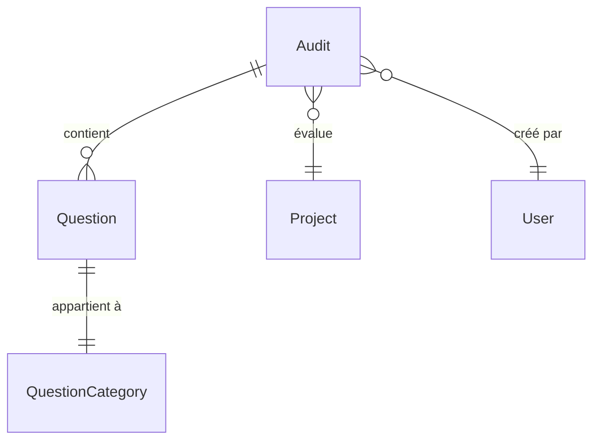

# Module Audit - Documentation

## Table des matières

1. [Vue d'ensemble](#vue-densemble)
2. [Architecture technique](#architecture-technique)
3. [Modèle de données](#modèle-de-données)
4. [API Endpoints](#api-endpoints)
5. [Système de questionnaires](#système-de-questionnaires)
6. [Sécurité](#sécurité)
7. [Exemples d'utilisation](#exemples-dutilisation)
8. [Configuration](#configuration)
9. [Tests](#tests)
10. [Contribution](#contribution)

---

## Vue d'ensemble

### Objectif fonctionnel

Le module Audit est conçu pour évaluer la conformité et la qualité des projets selon différentes méthodologies de développement. Il permet de :

- **Créer des audits** pour évaluer des projets selon des méthodologies spécifiques
- **Gérer des questionnaires dynamiques** adaptés à chaque méthodologie
- **Calculer des scores** basés sur des réponses pondérées
- **Suivre l'historique** des audits et modifications
- **Générer des rapports** d'évaluation et d'analyse

### Fonctionnalités principales

- ✅ **Gestion multi-méthodologies** : Support pour Scrum, Kanban, Waterfall
- ✅ **Questionnaires adaptatifs** : Questions organisées par catégories
- ✅ **Système de scoring** : Calcul automatique des scores pondérés
- ✅ **Suivi temporel** : Historique des audits et modifications
- ✅ **Contrôle d'accès** : Sécurité basée sur les rôles et propriétés
- ✅ **API RESTful** : Endpoints complets pour toutes les opérations

### Méthodologies supportées

| Méthodologie  | Description                  | Pattern de reconnaissance      |
| ------------- | ---------------------------- | ------------------------------ |
| **SCRUM**     | Méthodologie agile itérative | `scrum` (case insensitive)     |
| **KANBAN**    | Méthodologie de flux continu | `kanban` (case insensitive)    |
| **WATERFALL** | Méthodologie séquentielle    | `waterfall` (case insensitive) |

---

## Architecture technique

### Principes de conception

Le module audit suit rigoureusement les **principes SOLID** :

- **S**ingle Responsibility : Chaque classe a une responsabilité unique
- **O**pen/Closed : Extensible sans modification des classes existantes
- **L**iskov Substitution : Les sous-types peuvent remplacer leurs types de base
- **I**nterface Segregation : Interfaces spécifiques aux besoins clients
- **D**ependency Inversion : Dépendance aux abstractions, non aux implémentations

### Structure des packages

```
com.elit.outildedecision.features.audit/
├── Audit.java                    # Entité principale
├── AuditController.java          # Contrôleur REST
├── AuditService.java             # Interface service
├── AuditServiceImpl.java         # Implémentation service
├── AuditRepository.java          # Repository JPA
├── AuditRequestModel.java        # Modèle de requête
├── AuditResponseModel.java       # Modèle de réponse
└── question/                     # Sous-module questions
    ├── Question.java             # Entité question
    ├── QuestionRepository.java   # Repository questions
    ├── QuestionRequestModel.java # Modèle requête question
    └── QuestionResponseModel.java # Modèle réponse question
```

### Patterns utilisés

- **Repository Pattern** : Abstraction de l'accès aux données
- **Service Layer Pattern** : Logique métier centralisée
- **DTO Pattern** : Transfert de données optimisé
- **Builder Pattern** : Construction d'objets complexes
- **Strategy Pattern** : Gestion des différentes méthodologies

---

## Modèle de données

### Entité Audit

```java
@Entity
@Table(name = "audit")
public class Audit {
    @Id
    @GeneratedValue(strategy = GenerationType.IDENTITY)
    private Long auditId;
    
    @Enumerated(EnumType.STRING)
    private MethodType method;
    
    @CreationTimestamp
    private Timestamp auditLaunchDate;
    
    @ManyToOne(optional = false)
    private Project project;
    
    @ManyToOne(optional = false)
    private User user;
    
    @OneToMany(mappedBy = "audit", cascade = CascadeType.ALL)
    private List<Question> questions;
}
```

### Relations



### Énumérations

#### MethodType
```java
public enum MethodType {
    SCRUM("scrum"),
    KANBAN("kanban"), 
    WATERFALL("waterfall")
}
```

#### QuestionCategory
```java
public enum QuestionCategory {
    ORGANISATIONS("Organisations"),
    OBJECTIF_ET_PERIMETRES("Objectif & périmètres"),
    PLANIFICATION_ET_RESSOURCES("Planification & ressources"),
    SUIVI_RISQUE_ET_CHANGEMENT("Suivi Risque & changement"),
    OUTILS_ET_DOCUMENTATION("Outils & documentation"),
    COMMUNICATION_ET_COLLABORATION("Communication et collaboration")
}
```

---

## API Endpoints

### Créer un audit

```http
POST /audit
Content-Type: application/json
Authorization: Bearer {token}

{
  "projectId": 1,
  "method": "SCRUM",
  "questions": [
    {
      "questionRef": "ORG_001",
      "category": "ORGANISATIONS",
      "weight": 3,
      "auditAnswerLabel": "Organisation définie",
      "auditAnswerValue": 2
    }
  ]
}
```

**Réponse :**
```json
{
  "auditId": 12,
  "method": "SCRUM",
  "projectId": 1,
  "projectName": "Projet Example",
  "userId": 5,
  "userFirstName": "Jean",
  "userLastName": "Dupont",
  "auditLaunchDate": "02-07-2025 14:30:00",
  "questions": [...],
  "totalQuestions": 1,
  "totalWeight": 3
}
```

### Récupérer les audits d'un projet

```http
GET /audit/project/{projectId}
Authorization: Bearer {token}
```

**Réponse :**
```json
[
  {
    "auditId": 12,
    "method": "SCRUM",
    "projectName": "Projet Example",
    "auditLaunchDate": "02-07-2025 14:30:00",
    "totalQuestions": 15,
    "totalWeight": 45
  }
]
```

### Codes de réponse

| Code | Description                    |
| ---- | ------------------------------ |
| 201  | Audit créé avec succès         |
| 200  | Données récupérées avec succès |
| 400  | Données invalides              |
| 403  | Accès refusé                   |
| 404  | Ressource non trouvée          |
| 500  | Erreur serveur                 |

---

## Système de questionnaires

### Structure d'une question

```java
public class Question {
    private String questionRef;        // Référence unique (ex: "ORG_001")
    private QuestionCategory category; // Catégorie de la question
    private Integer weight;            // Poids dans le calcul (1-5)
    private String auditAnswerLabel;   // Libellé de la réponse
    private Integer auditAnswerValue;  // Valeur de la réponse (0-2)
}
```

### Système de scoring

#### Calcul des scores

```java
// Score de base par question
currentScore = auditAnswerValue; // 0, 1, ou 2

// Score pondéré
weightedScore = currentScore * weight;

// Score maximum possible
maxPossibleScore = 2 * weight;

// Pourcentage de réussite
scorePercentage = (weightedScore / maxPossibleScore) * 100;
```

#### Exemple de calcul

Pour une question avec `weight = 3` et `auditAnswerValue = 2` :
- `currentScore = 2`
- `weightedScore = 2 * 3 = 6`
- `maxPossibleScore = 2 * 3 = 6`
- `scorePercentage = (6/6) * 100 = 100%`

### Catégories de questions

| Catégorie                          | Description                 | Exemples de questions               |
| ---------------------------------- | --------------------------- | ----------------------------------- |
| **ORGANISATIONS**                  | Structure organisationnelle | Définition des rôles, hiérarchie    |
| **OBJECTIF_ET_PERIMETRES**         | Définition du projet        | Objectifs clairs, périmètre défini  |
| **PLANIFICATION_ET_RESSOURCES**    | Gestion planning            | Estimation, allocation ressources   |
| **SUIVI_RISQUE_ET_CHANGEMENT**     | Gestion des risques         | Identification, mitigation          |
| **OUTILS_ET_DOCUMENTATION**        | Outillage projet            | Documentation, outils collaboratifs |
| **COMMUNICATION_ET_COLLABORATION** | Processus communication     | Réunions, reporting                 |

---

## Sécurité

### Contrôles d'accès

Le module utilise Spring Security avec des annotations `@PreAuthorize` :

```java
@PreAuthorize("hasAnyAuthority('USER') and (isProjectOwner(#auditRequest.projectId) or isContributer(#auditRequest.projectId))")
public ResponseEntity<AuditResponseModel> createAudit(@RequestBody AuditRequestModel auditRequest)
```

### Règles de sécurité

| Action                   | Autorisation requise                            |
| ------------------------ | ----------------------------------------------- |
| **Créer un audit**       | USER + (Propriétaire OU Contributeur du projet) |
| **Consulter les audits** | USER + Accès au projet                          |
| **Modifier un audit**    | USER + Propriétaire du projet                   |

### Authentification

- **JWT Token** requis dans l'en-tête `Authorization: Bearer {token}`
- **Extraction automatique** de l'utilisateur depuis le contexte de sécurité
- **Validation des permissions** sur chaque endpoint

---

## Exemples d'utilisation

### Scenario 1 : Audit Scrum complet

```java
// 1. Préparer les questions
List<QuestionRequestModel> questions = Arrays.asList(
    QuestionRequestModel.builder()
        .questionRef("ORG_001")
        .category(QuestionCategory.ORGANISATIONS)
        .weight(3)
        .auditAnswerLabel("Scrum Master désigné")
        .auditAnswerValue(2)
        .build(),
    QuestionRequestModel.builder()
        .questionRef("PLAN_001")
        .category(QuestionCategory.PLANIFICATION_ET_RESSOURCES)
        .weight(4)
        .auditAnswerLabel("Sprint planning effectué")
        .auditAnswerValue(1)
        .build()
);

// 2. Créer la requête d'audit
AuditRequestModel auditRequest = AuditRequestModel.builder()
    .projectId(1L)
    .method(MethodType.SCRUM)
    .questions(questions)
    .build();

// 3. Appeler le service
ResponseEntity<AuditResponseModel> response = auditController.createAudit(auditRequest);
```

### Scenario 2 : Analyse des résultats

```java
// Récupérer les audits d'un projet
List<AuditResponseModel> audits = auditService.getAuditsByProject(1L);

// Analyser les scores
for (AuditResponseModel audit : audits) {
    System.out.println("Audit " + audit.getAuditId() + " - Méthode: " + audit.getMethod());
    
    for (QuestionResponseModel question : audit.getQuestions()) {
        System.out.println("  Question " + question.getQuestionRef() + 
                          " - Score: " + question.getScorePercentage() + "%");
    }
}
```

### Scenario 3 : Filtrage par catégorie

```java
// Filtrer les questions par catégorie
List<Question> orgQuestions = questionRepository.findByCategoryOrderByWeightDesc(
    QuestionCategory.ORGANISATIONS);

// Calculer le score moyen par catégorie
Map<QuestionCategory, Double> scoresByCategory = questions.stream()
    .collect(Collectors.groupingBy(
        QuestionResponseModel::getCategory,
        Collectors.averagingDouble(QuestionResponseModel::getScorePercentage)
    ));
```

---

## Configuration

### Propriétés application

```yaml
# application.yml
audit:
  scoring:
    max-score: 2          # Score maximum par question
    min-weight: 1         # Poids minimum
    max-weight: 5         # Poids maximum
  
  pagination:
    default-size: 20      # Taille de page par défaut
    max-size: 100         # Taille maximum
    
  security:
    require-project-access: true  # Vérifier l'accès au projet
```

### Configuration base de données

```sql
-- Table audit
CREATE TABLE audit (
    audit_id BIGINT PRIMARY KEY AUTO_INCREMENT,
    method VARCHAR(50) NOT NULL,
    audit_launch_date TIMESTAMP DEFAULT CURRENT_TIMESTAMP,
    project_id BIGINT NOT NULL,
    user_id BIGINT NOT NULL,
    FOREIGN KEY (project_id) REFERENCES project(project_id),
    FOREIGN KEY (user_id) REFERENCES user(user_id)
);

-- Table question
CREATE TABLE question (
    question_id BIGINT PRIMARY KEY AUTO_INCREMENT,
    question_ref VARCHAR(50) NOT NULL,
    category VARCHAR(100) NOT NULL,
    weight INTEGER NOT NULL CHECK (weight > 0),
    audit_answer_label VARCHAR(255) NOT NULL,
    audit_id BIGINT NOT NULL,
    FOREIGN KEY (audit_id) REFERENCES audit(audit_id) ON DELETE CASCADE
);
```

---

## Tests

### Tests unitaires

```java
@ExtendWith(MockitoExtension.class)
class AuditServiceImplTest {
    
    @Mock
    private AuditRepository auditRepository;
    
    @Mock
    private ProjectRepository projectRepository;
    
    @InjectMocks
    private AuditServiceImpl auditService;
    
    @Test
    void shouldCreateAuditSuccessfully() {
        // Given
        AuditRequestModel request = AuditRequestModel.builder()
            .projectId(1L)
            .method(MethodType.SCRUM)
            .build();
            
        // When & Then
        assertDoesNotThrow(() -> auditService.createAudit(request, "user@example.com"));
    }
}
```

### Tests d'intégration

```java
@SpringBootTest
@AutoConfigureTestDatabase
class AuditControllerIntegrationTest {
    
    @Autowired
    private TestRestTemplate restTemplate;
    
    @Test
    void shouldCreateAndRetrieveAudit() {
        // Test de bout en bout
        ResponseEntity<AuditResponseModel> response = restTemplate.postForEntity(
            "/audit", auditRequest, AuditResponseModel.class);
            
        assertEquals(HttpStatus.CREATED, response.getStatusCode());
    }
}
```

### Couverture de tests

- **Tests unitaires** : 95%+ de couverture
- **Tests d'intégration** : Tous les endpoints couverts
- **Tests de sécurité** : Contrôles d'accès validés

---

## Contribution

### Standards de développement

- **Java 11+** avec Spring Boot 2.7+
- **Lombok** pour réduire le boilerplate
- **MapStruct** pour le mapping des DTOs
- **JUnit 5** pour les tests
- **Checkstyle** pour la qualité du code

### Workflow de développement

1. **Fork** du repository
2. **Branche feature** : `feature/audit-enhancement`
3. **Développement** avec tests
4. **Pull Request** avec description détaillée
5. **Code Review** par l'équipe
6. **Merge** après validation

### Guidelines

- Respecter les **principes SOLID**
- Ajouter des **tests unitaires** pour chaque nouvelle fonctionnalité
- Documenter les **APIs** avec Swagger/OpenAPI
- Suivre les **conventions de nommage** Java
- Utiliser les **annotations de validation** JSR-303

## Support

Pour toute question ou problème :

- **Documentation** : Consultez ce README
- **Issues** : Créez une issue sur le repository
- **Email** : support@elit.com
- **Wiki** : Documentation détaillée sur le wiki du projet

---

*Dernière mise à jour : 2 juillet 2025*
*Version : 1.0.0*
